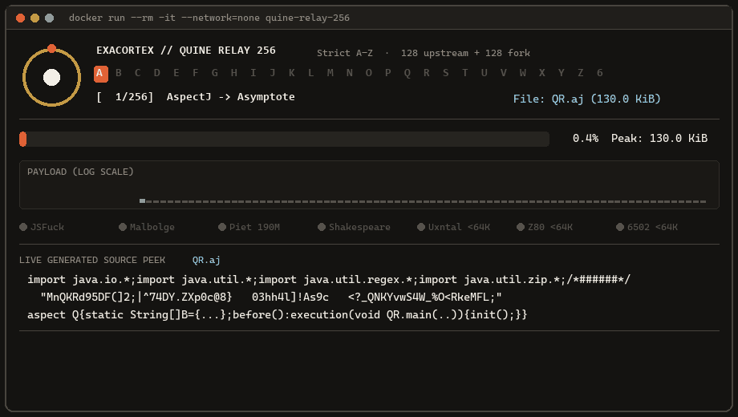
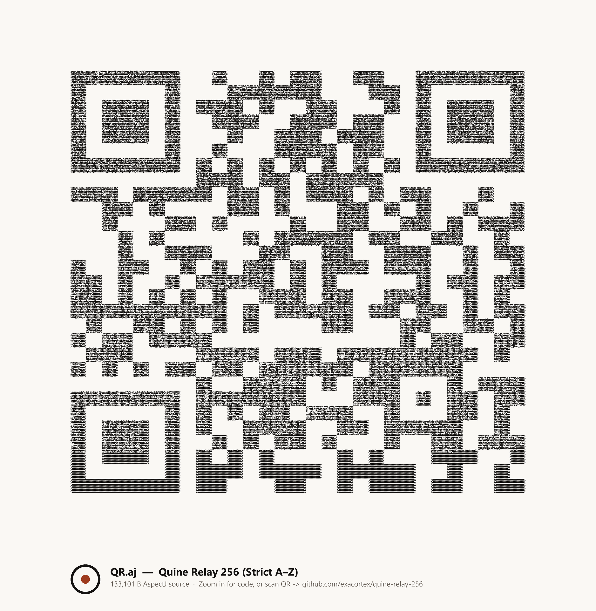
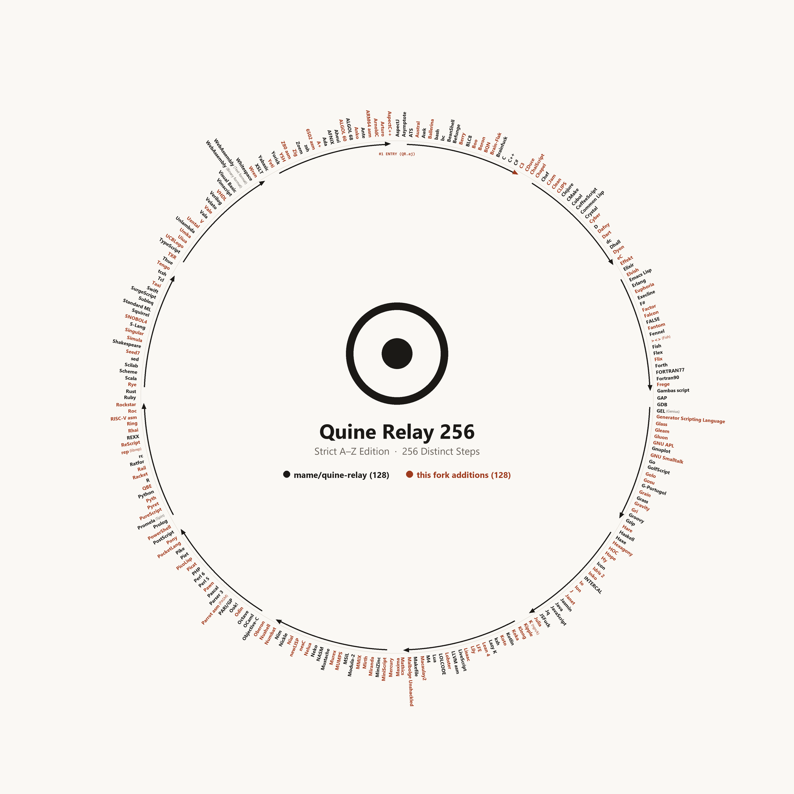
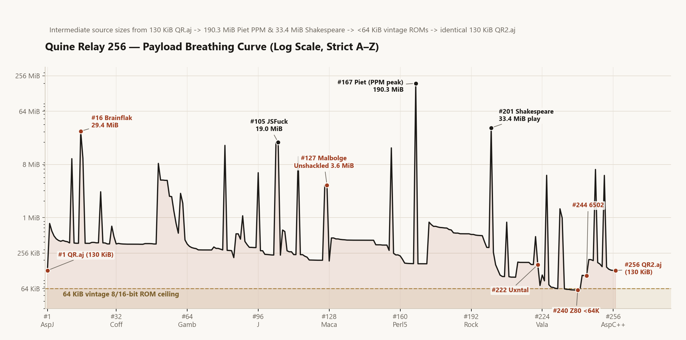

# Quine Relay 256 — Strict A–Z Edition

**All 128 languages from Yusuke Endoh's relay + 128 additions = 256 steps in strict A–Z alphabetical order**, forming a closed self-reproducing loop (`AspectJ -> Asymptote -> ATS -> ... -> Zsh -> 6502 asm -> A+ -> ... -> Arturo -> AspectC++ -> AspectJ`) — starting from a **real, scannable QR-code AspectJ program (`QR.aj`)** that points back to this repository.

<p align="center">
  
</p>

This fork builds on [Yusuke Endoh's (mame) Quine Relay](https://github.com/mame/quine-relay) (started in **2013**, MIT License). All **128** languages of Endoh's Ubuntu 26.04 relay are kept and run on the same upstream tools alongside **128** additions in this fork running on canonical third-party upstream compilers and interpreters, running offline in Docker (`--network=none`) as an unprivileged user (`USER qr`). Every step payload was rewritten for the strict A–Z cycle order. Separately, 11 Makefile commands differ in flags or build layout from upstream (`AspectJ`, `ALGOL 68`, `C#`, `F#`, `Visual Basic`, `FORTRAN77`, `Lazy K`, `Nim`, `Objective-C`, `Piet`, and `Shakespeare`).

<table>
  <tr>
    <td align="center" width="50%">
      <a href="thumbnail.png"></a><br>
      <sub><b><code>QR.aj</code> (133,101 B · 522×261)</b> — zoom in to read the AspectJ code, or scan the QR code to open <code>github.com/exacortex/quine-relay-256</code></sub>
    </td>
    <td align="center" width="50%">
      <a href="langs.png"></a><br>
      <sub><b>256-Language A–Z Wheel</b> — <code>mame/quine-relay</code> (128, black) + this fork (128, rust)</sub>
    </td>
  </tr>
</table>

<p align="center">
  <a href="assets/payload-curve.png"></a>
</p>

## Highlights

- **128 + 128 = 256 steps**: Includes all **128** languages from Endoh's Ubuntu 26.04 relay on the same upstream tools, paired with **128** additions in this fork (`16/20` restored historical `mame` languages + `Malbolge Unshackled` + `111` additional upstream-toolchain languages). Every one of our 128 additions uses a canonical third-party upstream toolchain with zero custom runners in `vendor/`. See [LANGUAGES.md](LANGUAGES.md) for the complete A–Z list and [RECORDS.md](RECORDS.md) for composition and design notes.
- **Scannable QR-code AspectJ seed (`QR.aj`, `133,101 B`, `130.0 KiB` / `133.1 kB`, `sha256: 85ae8e2a...`)**: Advice (`aspect Q { before(): execution(void QR.main(..)) { ... } } public class QR { public static void main(String[] a) {} }`) formatted by `src/qr_matrix.rb` + `src/gen-aj.rb` into a self-reproducing **29×29 ISO 18004 Version 3 EC-L QR code (`522×261`)** encoding `https://github.com/exacortex/quine-relay-256`. Zero file I/O, zero CLI code, and zero external processes. Inside the Ubuntu 26.04 Docker image (matching the image's system `zlib` and with `xa`, `z80asm`, and `uxnasm` on `PATH`), `cd src && rake` rebuilds `QR.aj` byte-identically.
- **Live ANSI Terminal Visualizer (`tools/relay_ui.py`)**: Interactive `docker run -it` runs wrap `make check -j 10000` with an animated ExaCortex ring-and-dot header, spinning 256-step A–Z dial, log-scale payload sparkline, milestone badges, live generated-source peek, and verification card. Non-interactive runs (`CI=true`, `NO_COLOR`, `--plain`, or redirected stdout) hand off immediately to unmodified `make check -j 10000`.
- **Strict A–Z alphabetical order (`out of order: 0`)**: Ignoring case and punctuation, every step proceeds in A–Z order around the 256-step cycle, rotated to enter at **Step #1 `AspectJ` (`QR.aj`)** so all three 16-bit 64 KiB hardware/VM targets (`6502 asm`, `Z80 asm`, `Uxntal`) sit near the compact inner tail and assemble well inside real `< 64 KiB` RAM/ROM limits, enforced by a `< 64,000 B` check in `src/gen-aj.rb` and `src/vm-exec.rb`:
  - **`6502 asm`** (`xa` + `sim65`): **`57,006 B / 65,012 B`** (`8,006 B` spare, `0.02s`, `exact=true`)
  - **`Z80 asm`** (`z80asm` + `tnylpo`): **`61,603 B / 64,991 B`** (`3,388 B` spare, `0.01s`, `exact=true`)
  - **`Uxntal`** (`uxnasm` + `uxncli`): **`55,661 B / 65,280 B`** (`9,619 B` spare, `0.10s`, `exact=true`)
- **Verified offline across all 3 Docker laps (`qr256-v32-verify`, `--network=none`, `USER qr`, `161.2 min` total)**:
  - **Engine & VM fast gates (`85ae8e2a...`)**: `self() == QR.aj` byte-for-byte (`133,101 B`), Phase 1 differential `224/224` exact (`fails=0`), Phase 2 `224/224` chain `check()`s and Ruby-vs-Java parity (`QR.asy` = `836,011 B`), and `vm-exec.rb` live execution on all three 16-bit ROMs (`PASS exact=true`).
  - **Lap A (`make all` + `SHA256SUMS` + UI checks)**: `256/256 PASS` in `38.1 min` (`2,284s`), `diff -s QR.aj QR2.aj` identical (`133,101 B`), `256/256` `SHA256SUMS`, non-TTY `relay_ui.py` fallback (`NONTTY_RC=0`), and interactive PTY demo (`PTY_DEMO_RC=0`).
  - **Lap B (In-image rebuild + harsh canary `"bad op "` -> `"Q'$@{( "`)**: byte-identical `cd src && rake` rebuild (`85ae8e2a...`), mutated canary `QR.aj` (`09e1ac7c...`, ROMs `56,994 B` / `61,695 B` / `55,743 B`) passed full round-trip in `38.6 min` (`2,316s`) changing `256/256` intermediate step hashes (`0` unchanged, `0` missing).
  - **Lap C (Full-build `strace` audit)**: `256/256 PASS` in `83.6 min` (`5,013s`), `256/256` `SHA256SUMS` match, `2,474` audit entries across `256` steps (`0` critical violations, `12` benign cross-step `QR*`/`qr*` accesses). See [`proof/AUDIT.md`](proof/AUDIT.md) and [`proof/RESULT.txt`](proof/RESULT.txt).

## Engineering Notes

- **Fork additions standard**: All **128** additions in this fork use canonical third-party upstream compilers and interpreters, pass no code on the command line, do not read payload data from files or stdin, and write strictly to stdout (with zero custom fork esolang runners in `vendor/`).
- **Classic 10-trit Malbolge limitation**: Because strict A–Z ordering pushes the `M` section to several hundred kilobytes, this fork uses `Malbolge Unshackled` rather than classic 10-trit Malbolge (whose `59,049`-cell ternary memory limit stands unbroken in classic Malbolge).
- **Generated seed vs. hand-crafted original**: `QR.aj` (`133,101 B`, `130.0 KiB`) is a generated, zlib-packed AspectJ program shaped as a scannable QR code — a different engineering exercise from Endoh's hand-crafted `13,664 B` `QR.rb`.
- **11 stdlib zlib unpacker steps** (`C#`, `CoffeeScript`, `Elixir`, `F#`, `Go`, `Groovy`, `Mathics`, `PowerShell`, `Tcl`, `V`, `Zig`) use their own language's standard library zlib/deflate implementation (zero external decompression binaries).
- **`Piet` & `Shakespeare` memory/disk peaks**: `QR.ppm` peaks at `199.6 MB` (`190.3 MiB`) uncompressed PPM, and compiling `Shakespeare` (`gcc -O0` on `QR.spl.c` from `35.1 MB` `QR.spl`) peaks near `~21 GB` RSS in `cc1`; plan for **>= 24 GB RAM** in your Docker VM when running a full lap.
- Full step-by-step inventory, `vendor/` provenance, and Makefile/`strace` implementation notes live in [LANGUAGES.md](LANGUAGES.md), [RECORDS.md](RECORDS.md), [proof/AUDIT.md](proof/AUDIT.md), and [proof/RESULT.txt](proof/RESULT.txt).

## Quick Start (Standalone Docker Build & Offline Proof Lap)

```bash
docker build --pull --no-cache -t quine-relay-256 .
docker run --rm -it --network=none quine-relay-256
```

This builds Ubuntu 26.04 with all 256 language toolchains, switches to non-root `USER qr`, and launches the live terminal visualizer around `make check -j 10000` (`QR.aj` -> `QR2.aj` offline, verifying `diff -s QR.aj QR2.aj` and `SHA256SUMS`). Omit `-it` (or pass `--plain`) for plain unmodified `make check` output, or run `make watch` / `python3 tools/relay_ui.py --demo` directly.

To regenerate `QR.aj` (with the `< 64,000 B` ROM guard, requiring `xa`, `z80asm`, and `uxnasm` on `PATH`) and all generated repository files inside the Ubuntu 26.04 Docker image:
```bash
cd src && rake
```

## History & Credits

- **2013–2026**: [Yusuke Endoh (@mametter)](https://github.com/mame/quine-relay) — original 50 / 100 / 128-language Quine Relay (MIT License).
- **2026-11-21**: `quine-relay-256` initial 256-language prototype (`QR.rb`).
- **2026-11-22**: Strict A–Z `AspectJ` seed refactor (`QR.aj`, non-root `USER qr`, `< 64,000 B` 6502/Z80/Uxntal ROMs).
- **2026-11-23**: Kept all 128 languages from upstream `mame/quine-relay` on the same upstream tools alongside 128 standalone additions = 256 steps (`QR.aj`).
- **2026-11-24**: Hardened `Ion` shell quoting using variable concatenation in 4,000-byte chunks (`QR.aj` `54,170 B`, v3.1), verified on all three offline Docker laps.
- **2026-11-25**: Reshaped `QR.aj` into a scannable 29×29 QR code (`133,101 B`), compacted `Asm6502` `.byt` strings and `ARM64` `.ascii` runs (bringing `Z80` & `Uxntal` ROMs under v3.1 sizes), added `tools/relay_ui.py` live visualizer (`CMD`), `thumbnail.png`, `langs.png`, `assets/payload-curve.png`, and `assets/terminal-demo.gif`, and completed full 3-lap offline Docker verification (`161.2 min`).

See [LICENSE](LICENSE) for full MIT license terms.
